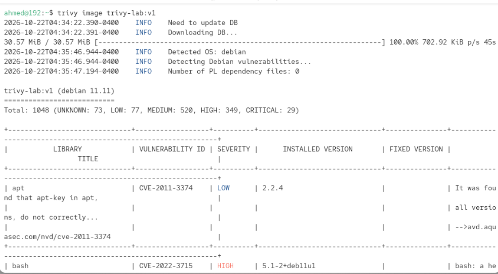
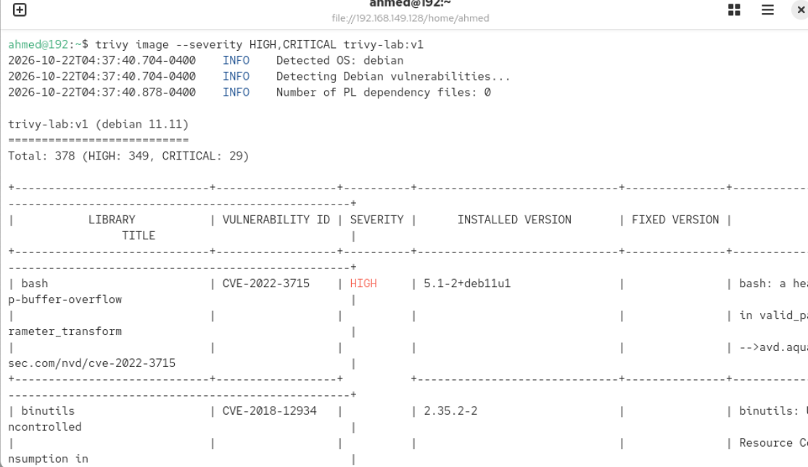
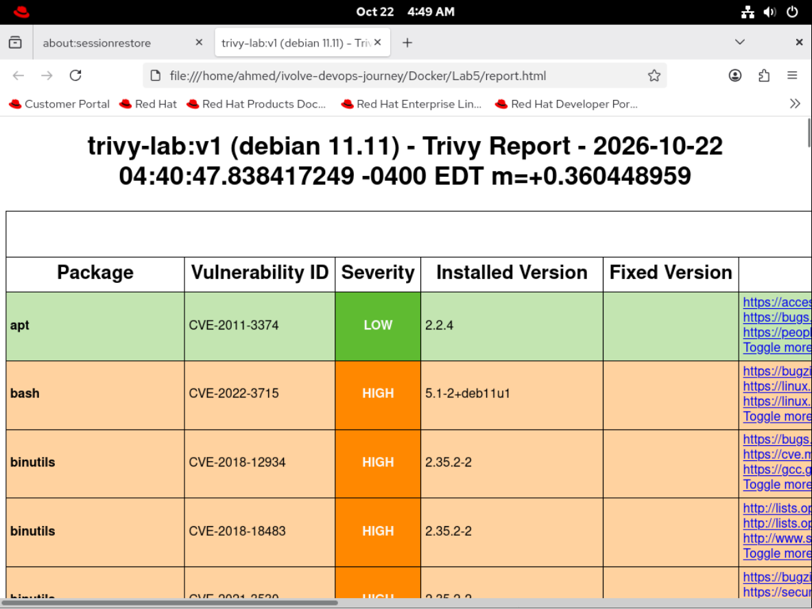
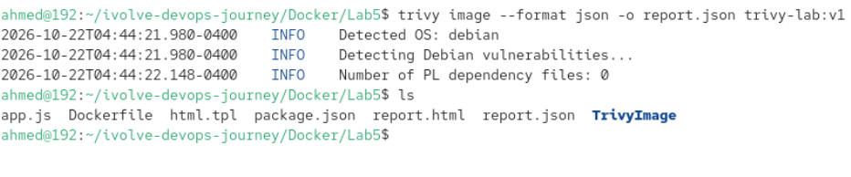

# Lab 5: Docker Image Vulnerability Scanning with Trivy 🛡️

Welcome to my repository for **Lab 5** of the **iVolve DevOps Journey**. In this lab, I practiced container security by building a Docker image and scanning it for vulnerabilities using **Trivy**, ensuring the application is safe before deployment.

---

## 🛠️ Prerequisites & Environment
* **Operating System:** Red Hat Enterprise Linux (RHEL)
* **Container Engine:** Docker
* **Security Scanner:** Trivy

---

## 🚀 Step-by-Step Implementation

### 1. Clone the Application & Dockerfile
First, I cloned the lab repository containing the application code and `Dockerfile`, then navigated into the project directory:
```bash
git clone [https://github.com/Ibrahim-Adel5/TrivyImage.git](https://github.com/Ibrahim-Adel5/TrivyImage.git)
CD TrivyImage
```
[cite: 1]

### 2. Build the Docker Image
I built the Docker image from the provided `Dockerfile` and tagged it with `trivy-lab:v1`:
```bash
docker build -t trivy-lab:v1 .
```
[cite: 1]

### 3. Install & Verify Trivy
Since I am working on a RHEL-based environment, I installed the appropriate Trivy package and verified the installation:
```bash
sudo rpm -ivh [https://github.com/aquasecurity/trivy/releases/download/v0.18.3/trivy_0.18.3_Linux-64bit.rpm](https://github.com/aquasecurity/trivy/releases/download/v0.18.3/trivy_0.18.3_Linux-64bit.rpm)
trivy --version
```
[cite: 1]

### 4. Scan the Docker Image for Vulnerabilities
I ran a vulnerability scan on the built image to identify existing security issues in the dependencies and base image:
```bash
trivy image trivy-lab:v1
```

[cite: 1]

### 5. Filter HIGH and CRITICAL Vulnerabilities
To focus only on severe security risks that require immediate attention, I filtered the scan results for `HIGH` and `CRITICAL` severities:
```bash
trivy image --severity HIGH,CRITICAL trivy-lab:v1
```


[cite: 1]

### 6. Generate the Vulnerability Report
Finally, I exported the scan results into a structured format (`report.json`) to document the security findings:




trivy image --format template --template "@/contrib/html.tpl" -o report.html trivy-lab:v1
trivy image --format json -o report.json trivy-lab:v1

Conclusion
This lab helped me understand the importance of Container Security and how DevOps engineers integrate security scanning into their CI/CD pipelines to catch vulnerabilities early.
