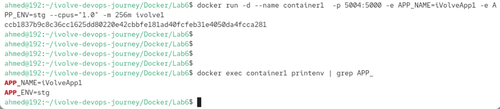
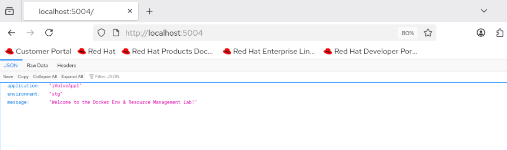
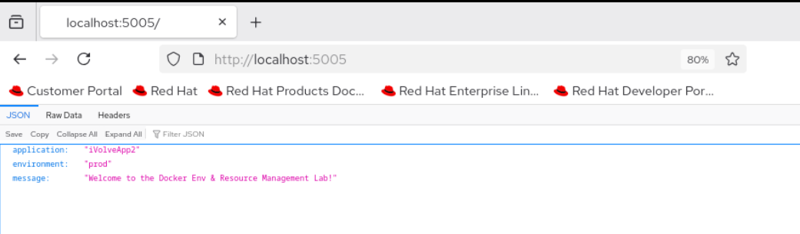
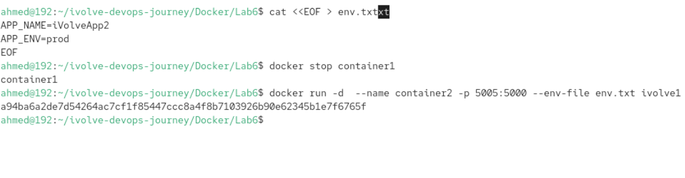
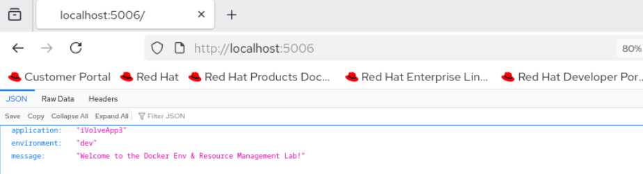
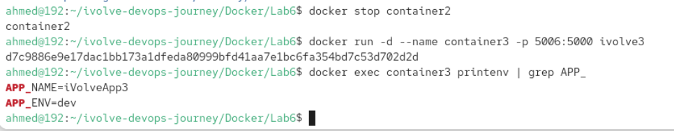

# Docker Environment Variables & Resource Management Lab 🚀

Welcome to my submission for **Lab 6: Docker Environment Variables and Resource Management**.  
This repository contains the setup, Dockerfiles, and step-by-step commands used to build, containerize, and configure a Python application with custom environment variables and strict resource limits.

---

## 📌 Objectives
1. Build and containerize a Python Flask application using Docker.
2. Manage environment variables using multiple approaches:
   - Direct injection via CLI flags (`-e`).
   - Loading from external environment files (`--env-file`).
   - Hardcoding variables inside the `Dockerfile` (`ENV`).
3. Enforce CPU and Memory resource restrictions on containers.
4. Verify application responsiveness and environment configuration.

---

## 🛠️ Step-by-Step Implementation

### Step 1: Clone Repository
```bash
git clone [https://github.com/Ibrahim-Adel15/PythonApp.git](https://github.com/Ibrahim-Adel15/PythonApp.git)
cd PythonApp
```

Step 2: Containerization (container1 - CLI Environment Variables)
1. Dockerfile Creation
Created a lightweight Dockerfile based on python:3.12-slim:

Dockerfile
FROM python:3.12-slim
WORKDIR /app
COPY . /app
RUN pip install --no-cache-dir -r requirements.txt
EXPOSE 5000
CMD ["python", "app.py"]
2. Build Image
Bash
docker build -t ivolve1 .
3. Run Container with Resource Limits & Environment Variables
Ran container1 mapped to host port 5004 (to avoid host port conflicts) with a limit of 1 CPU and 256MB RAM:

Bash
docker run -d --name container1   -p 5004:5000  -e APP_NAME=iVolveApp1 -e APP_ENV=stg --cpus="1.0" -m 256m ivolve1



4. Verification & Resource Monitoring
App Response Check:

Bash
curl http://localhost:5004
Environment Variables Inspection:

Bash
docker exec container1 printenv | grep APP_
Live Resource Usage Monitoring:

Bash
docker stats container1

Step 3: Containerization (container2 - File-Based Environment Variables)
1. Create env.txt File
Plaintext
APP_NAME=iVolveApp2
APP_ENV=prod
2. Run Container using --env-file
Ran container2 mapped to host port 5005:

Bash
docker run -d --name container2  -p 5005:5000 --env-file env.txt ivolve1


3. Verification
Bash
curl http://localhost:5005
docker exec container2 printenv | grep APP_
Step 4: Containerization (container3 - Hardcoded Dockerfile Variables)
1. Create Dockerfile.dev
Created a dedicated Dockerfile injecting default ENV values:

Dockerfile
FROM python:3.12-slim
WORKDIR /app
COPY . /app
RUN pip install --no-cache-dir -r requirements.txt
ENV APP_NAME=iVolveApp3
ENV APP_ENV=dev
EXPOSE 5000
CMD ["python", "app.py"]
2. Build New Image
Bash
docker build -f Dockerfile.dev -t ivolve3 .
3. Run Container
Ran container3 mapped to host port 5006:

Bash
docker run -d   --name container3 -p 5006:5000 ivolve3




4. VerificationBashcurl http://localhost:5006
docker exec container3 printenv | grep APP_
📊 Summary ComparisonContainer NameMapped PortEnv SourceAPP_NAMEAPP_ENVResource Limitscontainer15004:5000CLI -e flagsiVolveApp1stg1 CPU / 256MB RAMcontainer25005:5000File (env.txt)iVolveApp2prodSystem Defaultcontainer35006:5000Dockerfile (ENV)iVolveApp3devSystem Default👨‍💻 AuthorAhmed FaroukCloud DevOps Trainee
