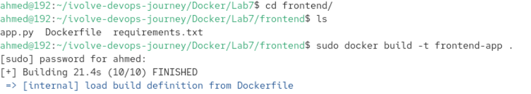
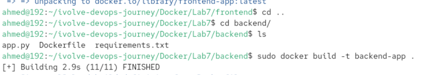
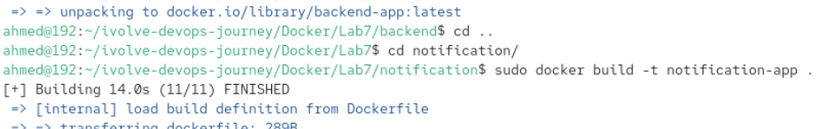
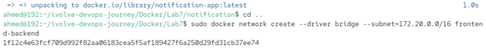
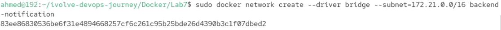
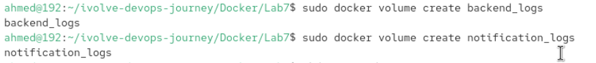
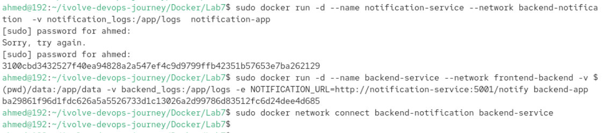
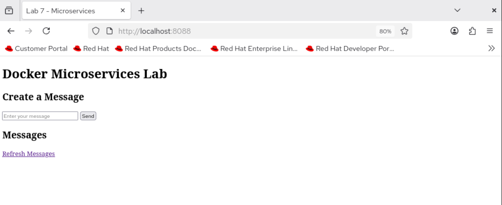
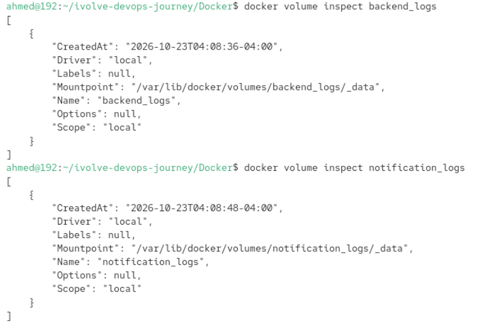

# Multi-Network Microservices Application Deployment

This project demonstrates a production-grade multi-container architecture using **Docker**, **Custom Bridge Networks**, **Docker Volumes**, and **Bind Mounts** on Red Hat Enterprise Linux (RHEL).

---

## 🏗 Architecture Overview

The application consists of three independent microservices communicating over HTTP:

1. **Frontend Service** (Flask, Port `3000` inside / Mapped to `8088` on Host)
   - Serves the user interface to create and view messages.
   - Communicates with the Backend service via environment variables (`BACKEND_URL`).
2. **Backend Service** (Flask, Port `5000`)
   - Implements core business logic, accepts, and processes messages.
   - Persists application messages to a host-mapped directory using a **Bind Mount**.
   - Writes application logs to a managed **Docker Volume**.
   - Forwards notification events to the Notification service (`NOTIFICATION_URL`).
3. **Notification Service** (Flask, Port `5001`)
   - Simulates notification delivery by logging events.
   - Writes log entries to a managed **Docker Volume**.

---

## 🔒 Network Architecture & Security

To enforce network segregation and strict traffic isolation, two custom bridge networks are implemented:

* `frontend-backend` (`172.20.0.0/16`): Isolates Frontend-to-Backend communication.
* `backend-notification` (`172.21.0.0/16`): Isolates Backend-to-Notification communication.

> **Security Note:** The Frontend service cannot communicate directly with the Notification service, preserving a clean multi-tier security boundaries model.

---

## 🚀 Deployment Steps

### 1. Clone the Repository
```bash
git clone [https://github.com/Ibrahim-Adel15/MicroserviceApp.git](https://github.com/Ibrahim-Adel15/MicroserviceApp.git)
cd MicroserviceApp
```
2. Build Docker Images





Bash
# Frontend Image
docker build -t frontend-app ./frontend

# Backend Image
docker build -t backend-app ./backend

# Notification Image
docker build -t notification-app ./notification

3. Create Custom Networks



Bash
docker network create --driver bridge --subnet=172.20.0.0/16 frontend-backend
docker network create --driver bridge --subnet=172.21.0.0/16 backend-notification

4. Create Volumes & Data Directories



Bash
# Named Volumes for Application Logs
docker volume create backend_logs
docker volume create notification_logs

# Host Directory for Bind Mount (Data Persistence)
mkdir -p ./data


5. Run Containers

A. Notification Service
Bash
docker run -d \
  --name notification-service \
  --network backend-notification \
  -v notification_logs:/app/logs \
  notification-app
B. Backend Service
Bash
docker run -d \
  --name backend-service \
  --network frontend-backend \
  -v \$(pwd)/data:/app/data \
  -v backend_logs:/app/logs \
  -e NOTIFICATION_URL=http://notification-service:5001/notify \
  backend-app

# Connect Backend to the notification network
docker network connect backend-notification backend-service

C. Frontend Service
Bash
docker run -d \
  --name frontend-service \
  --network frontend-backend \
  -p 8088:3000 \
  -e BACKEND_URL=http://backend-service:5000 \
  frontend-app

  🔍 Verification & Testing
Access the Web Interface: Open your browser and navigate to http://localhost:8088.

Verify Persistence: Check ./data/messages.json on the host machine to verify messages are stored via the Bind Mount.
Inspect Logs:

Bash
docker volume inspect backend_logs
docker volume inspect notification_logs
