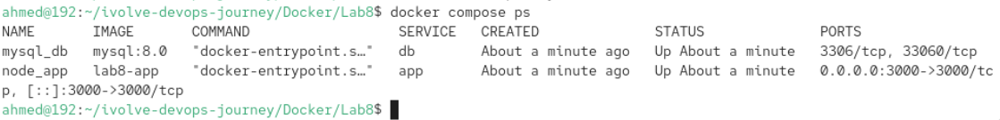
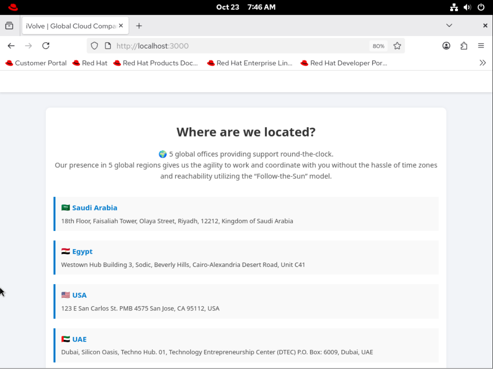
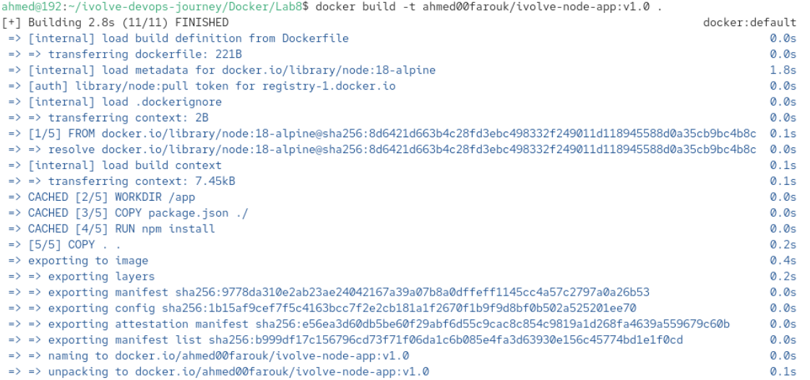
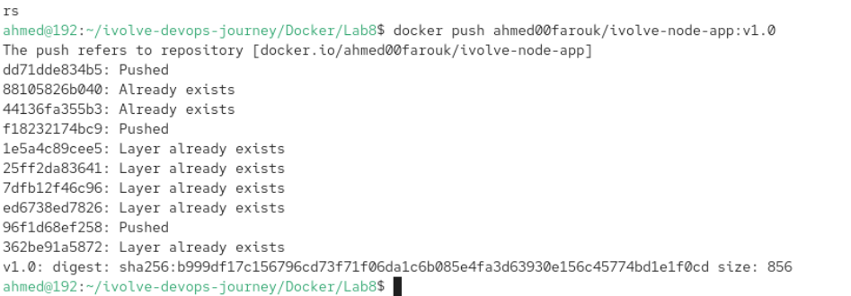
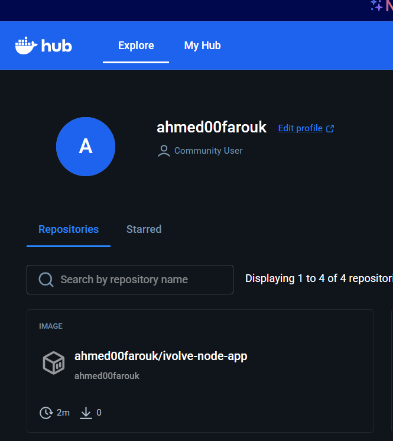

# Lab 8: Containerized Node.js and MySQL Stack Using Docker Compose

This repository contains the solution for **Lab 8**, which demonstrates how to containerize a Node.js web application connected to a MySQL database using Docker Compose, implement persistent storage, isolate container communication via custom networks, and push the final image to Docker Hub.

---

## 🛠️ Project Architecture & Features

- **Node.js App**: Custom web application built from Dockerfile.
- **MySQL Database**: Persistent relational database initialized with the `ivolve` database.
- **Persistence**: Volumes configured for both database records and application logs.
- **Networking**: Custom bridge network (`ivolve-net`) ensuring isolated inter-service communication.
- **Docker Hub**: Application image built, tagged, and published to Docker Hub registry.

---

1. Clone the Repository
Bash
git clone [https://github.com/Ibrahim-Adel15/iVolveApp.git](https://github.com/Ibrahim-Adel15/iVolveApp.git)
cd iVolveApp
2. Configure Environment & Stack
The docker-compose.yml file sets up both services:

Database Service (db): Uses mysql:8.0, exposes internal port 3306, auto-creates database ivolve, and mounts volume db_data at /var/lib/mysql.

Application Service (app): Builds local image, maps host port 3300 or 3000 to container port 3000, connects to db, and mounts volume app_logs at /app/logs.

💻 Execution & Verification
Start the Stack

Run the containers in detached mode:

Bash
docker compose up -d
Check Container Status
Verify that both containers are up and healthy:

Bash
docker compose ps
Test Application Connectivity
Test local access to verify DB connection:

Bash
curl http://localhost:3000

Docker Hub Image Publishing
Log in to Docker Hub:

Bash
docker login
Tag the Built Image:

Bash
docker tag lab8-app ahmed00farouk/ivolve-node-app:v1.0

Push to Docker Hub:

Bash
docker push ahmed00farouk/ivolve-node-app:v1.0

